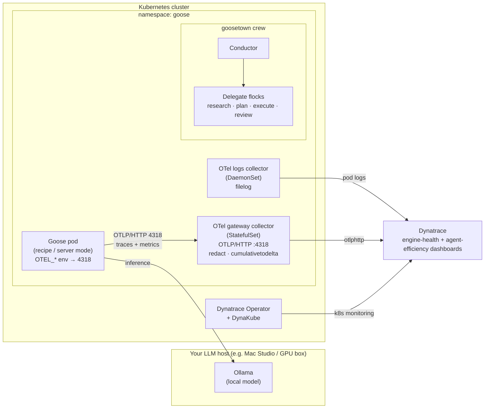

# Observing Goose AI Agents with OpenTelemetry & Dynatrace

Go from an empty Kubernetes cluster to a fully **observed**, BMAD-style
[Goose](https://block.github.io/goose/) agent crew — a simple agent, MCP tools
(Dynatrace + GitHub), a multi-agent orchestration, and native OpenTelemetry
flowing into Dynatrace with **zero application code changes**.

This is the companion repository for the *isItObservable* Goose AI episode. It is
built to be **reusable**: you bring your own cluster, your own Ollama host, and
your own Dynatrace tenant — all supplied through a single `.env` file. There is
nothing lab-specific hard-coded anywhere.

> **What is Goose?** Goose is [Block's](https://block.github.io/goose/) open,
> on-machine AI agent (Apache-2.0, written in Rust, now under the AI Agent
> ecosystem umbrella of the Linux Foundation). It runs *any* LLM — including a
> local [Ollama](https://ollama.com/) model, so nothing leaves your network —
> speaks the **Model Context Protocol (MCP)** natively (70+ extensions), and
> packages work as reusable **YAML recipes**. Crucially for us, recent Goose
> emits **native OpenTelemetry** traces and metrics: you observe it without
> writing a line of instrumentation code.

---

## Architecture



The Goose pod runs your recipes and talks to a **local Ollama** model for
inference (nothing leaves your network). It exports **native OpenTelemetry** over
**OTLP/HTTP on port 4318** to an in-cluster **gateway collector** (a
`StatefulSet`), which redacts prompt content, converts cumulative metrics to
delta, and forwards to **Dynatrace**. A second **DaemonSet** collector tails pod
logs. Two Dynatrace dashboards visualise **engine health** and **agent
efficiency**.

---

## Prerequisites

| You need | Notes |
|---|---|
| A Kubernetes cluster | Any conformant cluster: kind/k3s for local, or EKS/GKE/AKS, or a Proxmox + Cluster API setup. See [`cluster/`](cluster/). |
| `kubectl` + `helm` | Pointed at your cluster. |
| An Ollama host | Reachable from the cluster. A Mac Studio, a GPU workstation, or any Ollama server. |
| A Dynatrace tenant | SaaS or Managed, plus API + data-ingest tokens. |
| A GitHub token | For the GitHub MCP demo (repo scope). |
| Goose CLI (optional) | To run recipes locally as well as in-cluster: <https://block.github.io/goose/docs/getting-started/installation>. Pinned to **v1.46.0** in this tutorial. |

---

## Quickstart

```bash
# 1. Configure — copy the template and fill in YOUR values
cp .env.example .env
$EDITOR .env

# 2. Install the operators (OpenTelemetry + Dynatrace) and the DynaKube
make operators

# 3. Deploy the two collectors (logs DaemonSet + gateway StatefulSet)
make deploy-collector

# 4. Deploy Goose (wired to Ollama + the collector)
make deploy-goose

# 5. Run a simple agent, then add MCP tools, then the full crew
make simple-agent
make wire-mcp
make crew

# 6. Deploy the Dynatrace dashboards (dtctl apply -f dashboards/*.yaml)
make dashboards

# 7. Open the chat UI, submit a goal, and watch the dashboards fill
make goosetown
```

Or run the whole path at once: `make all`. Tear it all down with `make teardown`.

Each step maps to a numbered script in [`scripts/`](scripts/) and a tutorial
section below, so the automation and the walkthrough stay in lockstep.

---

## Tutorial sections

0. **Prerequisites & architecture** — this page.
1. **[Provision a cluster](cluster/README.md)** — bring your own, or use Cluster API.
2. **Install the operators** — [`k8s/operators/`](k8s/operators/) · `make operators`.
3. **Point Goose at Ollama** — [`config/goose-config.yaml`](config/goose-config.yaml).
4. **Deploy Goose** — [`k8s/goose/`](k8s/goose/) · `make deploy-goose`.
5. **Build a simple agent** — [`recipes/01-simple-agent.yaml`](recipes/01-simple-agent.yaml).
6. **Wire the MCPs** — [`recipes/02-dynatrace-mcp.yaml`](recipes/02-dynatrace-mcp.yaml), [`03-github-mcp.yaml`](recipes/03-github-mcp.yaml), [`05-pr-review.yaml`](recipes/05-pr-review.yaml).
7. **Orchestrate a BMAD crew (goosetown)** — in-process [`config/goosetown/`](config/goosetown/), or ACP-deployed [`recipes/bmad/`](recipes/bmad/) + [`k8s/goose/bmad/`](k8s/goose/bmad/).
8. **Observe it** — [`docs/observability.md`](docs/observability.md) · deploy the dashboards with `dtctl apply -f dashboards/*.yaml` (YAML in [`dashboards/`](dashboards/)).
9. **Connect to the chat interface & run the crew** — open the chat UI, submit a goal, watch the dashboards fill ([below](#connect-to-the-chat-interface-and-run-the-crew)).
10. **Teardown** — `make teardown`.

### The BMAD crew: in-process (default) vs. ACP-deployed

The crew runs a **Conductor** through a `research → plan → execute → review`
loop over four **Delegate flocks**, following one golden rule: **READS run in
parallel** (researcher, reviewer), **WRITES run sequentially** (planner →
executor). There are two ways to run it, and this repo ships both.

**1. In-process (the working default).** A Conductor runs the crew from a single
recipe and spawns the five BMAD delegates — Analyst, PM, Architect, Developer,
QA — as its own Goose subagent sessions (via `sub_recipes` / the summon
`delegate` tool). Each delegate broadcasts on the shared Town Wall and appears as
its own goose on the Goose Town map.

```bash
make crew                   # runs recipes/04-bmad-crew.yaml
```

The delegate recipes live in [`recipes/bmad/`](recipes/bmad/)
(`analyst.yaml` / `pm.yaml` / `architect.yaml` / `dev.yaml` / `qa.yaml`); the
descriptive flock roster is in [`config/goosetown/`](config/goosetown/).

**From the Goose Town UI (the map).** The chat box (`goose-chat`, port 4250)
treats each message as a **crew goal**: it runs `recipes/04-bmad-crew.yaml` with
`--params goal=<msg>`, so you can type a goal and watch the resulting crew run
land as live telemetry on the two dashboards (the reliable payoff; the animated
village map is a future stretch — see
[Connect to the chat interface & run the crew](#connect-to-the-chat-interface-and-run-the-crew)).
This UI path is **read-only** — every delegate's GitHub MCP
runs with `--read-only` and the Developer delegate plans but never writes — so a
board prompt can never trigger an unintended repository write. Because the
delegates run in-process they share one `OTEL_SERVICE_NAME`; per-role breakdown
on the map is by session name, not `service.name` (see
[`docs/observability.md`](docs/observability.md) Gotcha 5). For a write-capable,
per-service-name crew, use the ACP form below.

**2. ACP-deployed (the upgrade path).** Each role becomes its **own** Goose
agent — a Deployment + Service in the cluster — so the Conductor can dispatch
to the roles as addressable **ACP** (Agent Client Protocol) endpoints. The
per-role recipes are in [`recipes/bmad/`](recipes/bmad/) and the manifests in
[`k8s/goose/bmad/`](k8s/goose/bmad/); each role sets its **own**
`OTEL_SERVICE_NAME` (`goose-conductor`, `goose-researcher`, `goose-planner`,
`goose-executor`, `goose-reviewer`).

```bash
make bmad-crew-acp          # applies k8s/goose/bmad/ then launches the conductor
```

| Role | Recipe | Access | Concurrency |
|---|---|---|---|
| Conductor | [`conductor.yaml`](recipes/bmad/conductor.yaml) | ACP client (dispatches) | orchestrates |
| Researcher | [`researcher.yaml`](recipes/bmad/researcher.yaml) | read-only · GitHub + Dynatrace MCP | parallel-safe |
| Planner | [`planner.yaml`](recipes/bmad/planner.yaml) | writes the plan only (no MCP) | sequential |
| Executor | [`executor.yaml`](recipes/bmad/executor.yaml) | writes repo · GitHub MCP | sequential |
| Reviewer | [`reviewer.yaml`](recipes/bmad/reviewer.yaml) | read-only · GitHub MCP | parallel-safe |

> **⭐ Trace continuity — verified against v1.46.0.** The point of the ACP form
> is to see the whole crew run as **one distributed trace** spanning the per-role
> service names, which only works if the Conductor propagates the W3C
> `traceparent` across each ACP hop — the same crux the CrewAI episode hit. We
> checked the pinned Goose **v1.46.0** and it does **not** support this: `goose
> acp` runs an ACP agent server **on stdio only** (not the HTTP `ACP_*_URL`
> endpoints these manifests assume — ACP-over-HTTP is unreleased upstream, goose
> issue [#6642](https://github.com/block/goose/issues/6642)), and it does not
> auto-forward `traceparent` (ACP reserves `_meta.traceparent` only as a
> client-side convention). **So the in-process `make crew`
> (`recipes/04-bmad-crew.yaml`) is the working default; `recipes/bmad/` +
> `k8s/goose/bmad/` are the documented upgrade path**, unblocked only when
> ACP-over-HTTP lands *and* the Conductor injects `_meta.traceparent`. The
> observability story (per-role spans, redaction, delta metrics) is identical
> either way. Full analysis + the per-role dashboard breakdown and single-trace
> check: [`docs/observability.md` §6](docs/observability.md).

### Try it: an agent that reviews your pull requests

Section 6 wires two MCP servers into Goose — Dynatrace (read your telemetry) and
GitHub (read and act on a repo). The GitHub MCP is what turns a chat agent into a
teammate. The [`05-pr-review.yaml`](recipes/05-pr-review.yaml) recipe shows the
pattern end-to-end: the agent **reads** a pull request (metadata, changed files,
diff), writes a structured review — summary, per-file notes, and an
`APPROVE` / `REQUEST_CHANGES` / `COMMENT` verdict — then **posts** that review
back to the PR in a single action. Point `DEMO_REPO` at a repo you control (it
posts a real review) and run:

```bash
make review-pr              # review the latest open PR on $DEMO_REPO
make review-pr PR=42        # review PR #42
```

Because it runs inside the instrumented Goose pod, the whole read → reason → post
flow shows up as one span tree in the dashboards — you can see exactly which MCP
tool calls the agent made and how long each took.

### Connect to the chat interface and run the crew

This is the payoff: type a goal into a chat box, and watch the two dashboards you
just deployed fill with live telemetry from the crew that runs it.

**Prerequisites.** You've deployed the collectors (`make deploy-collector`), Goose
(`make deploy-goose`), goosetown (`make goosetown`), and the dashboards
(`dtctl apply -f dashboards/*.yaml`, or `make dashboards`).

**1. Open the chat UI.** goosetown exposes a `LoadBalancer` service that carries
both the map dashboard (port 80) and the chat interface (port 4251):

```bash
# grab the external address
kubectl -n goosetown get svc goosetown-ui
# → open  http://<EXTERNAL-IP>:4251  for the chat interface

# no LoadBalancer? port-forward instead:
kubectl -n goosetown port-forward svc/goosetown-ui 4251:4251
# → open  http://localhost:4251
```

**2. Submit a goal.** Type a goal into the box and hit send. Each message is
treated as an independent **crew goal**: the server launches the in-process BMAD
crew (`recipes/04-bmad-crew.yaml`) with `--params goal=<your message>`, and the
Conductor spawns the five delegates — Analyst, PM, Architect, Developer, QA. The
whole path is **read-only** (every delegate's GitHub MCP runs with `--read-only`,
and the server also exports `GITHUB_READ_ONLY=1`), so a typed goal can never
trigger a repository write. A safe first goal:

```
Add a /healthz endpoint to the sample service
```

**3. Watch the dashboards fill.** This is the reliable, demonstrable result.
Within a few seconds of submitting the goal, the crew starts emitting telemetry
and both dashboards come alive:

- **Goose — Engine Health**: token usage, session duration, and tool-call vs
  tool-completion counts climb as the crew works.
- **Goose — Agent Efficiency**: the `gen_ai` span tree shows per-tool latency and
  which model/tools the delegates lean on, keyed by session.

Because the chat crew runs **in-process**, all five delegates share one
`service.name` (`goose-goosetown`); the per-role breakdown is by **session /
delegate name** (`bmad-analyst`, `bmad-pm`, `bmad-architect`, `bmad-dev`,
`bmad-qa`), not by `service.name` — see
[`docs/observability.md`](docs/observability.md) Gotcha 5.

> **About the village map.** The chat UI ships alongside a Goose Town village map,
> and the same session names that split the dashboards are what light the geese on
> it. Treat the animated map as a work in progress, not the guaranteed payoff:
> because we run the crew in-process (one `service.name`, no per-role service
> topology behind the map), a fully animated per-role "moving geese" view is a
> future stretch, not something this tutorial promises. The dependable result you
> can demo today is the **dashboards filling** — that's the signal that the
> chat → crew → telemetry path is working end to end.

---

## The observability gotchas (read these before you debug)

Three things trip up almost everyone wiring Goose to OpenTelemetry. They are
covered in depth in [`docs/observability.md`](docs/observability.md); the short
version:

1. **Goose speaks OTLP/HTTP only — use port `4318`, never `4317`.** Goose has no
   gRPC exporter. Point `OTEL_EXPORTER_OTLP_ENDPOINT` at the collector's **HTTP**
   receiver or you'll see nothing.

2. **`GOOSE_TELEMETRY_ENABLED` is product analytics, *not* OTLP.** Turning it on
   does **not** send traces to your collector. Native OTel is controlled by the
   standard `OTEL_*` environment variables. (Same trap the CrewAI episode hit.)

3. **Redact prompt content before it leaves the cluster.** Goose spans can carry
   `user_message`, `trace_input`, and `input` attributes containing raw prompts.
   The gateway collector drops these with a `transform` processor **before**
   export so prompts never land in your backend.

---

## Repository layout

```
.
├── README.md              ← you are here
├── .env.example           ← copy to .env, set YOUR parameters
├── Makefile               ← one-liner targets wrapping scripts/
├── docs/                  ← architecture + observability deep-dive
├── cluster/               ← bring-your-own-cluster notes + values template
├── recipes/               ← Goose recipes (the reusable, shareable unit)
├── config/                ← goose config + goosetown crew definitions
├── k8s/                   ← operators, collectors, Goose deployment
├── dashboards/            ← Dynatrace dashboards (dtctl YAML)
└── scripts/               ← numbered, idempotent deploy scripts
```

## License

Apache-2.0 — see [LICENSE](LICENSE).
