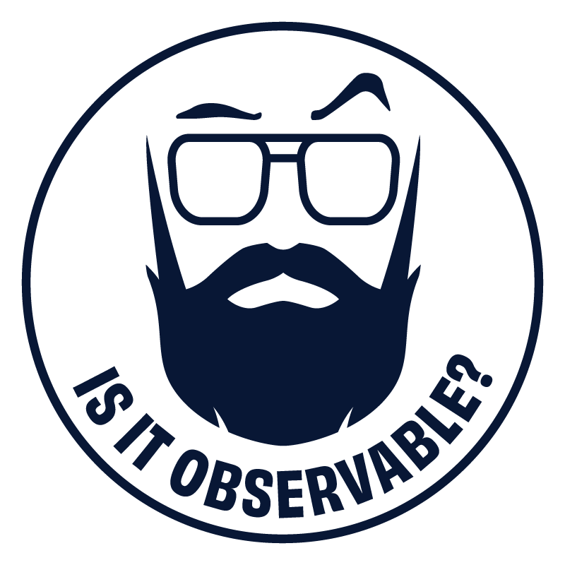
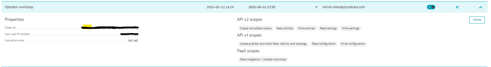
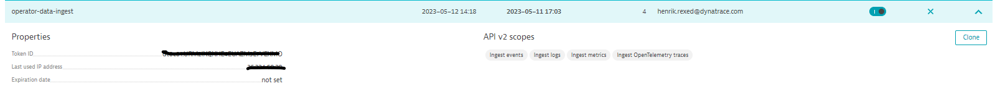
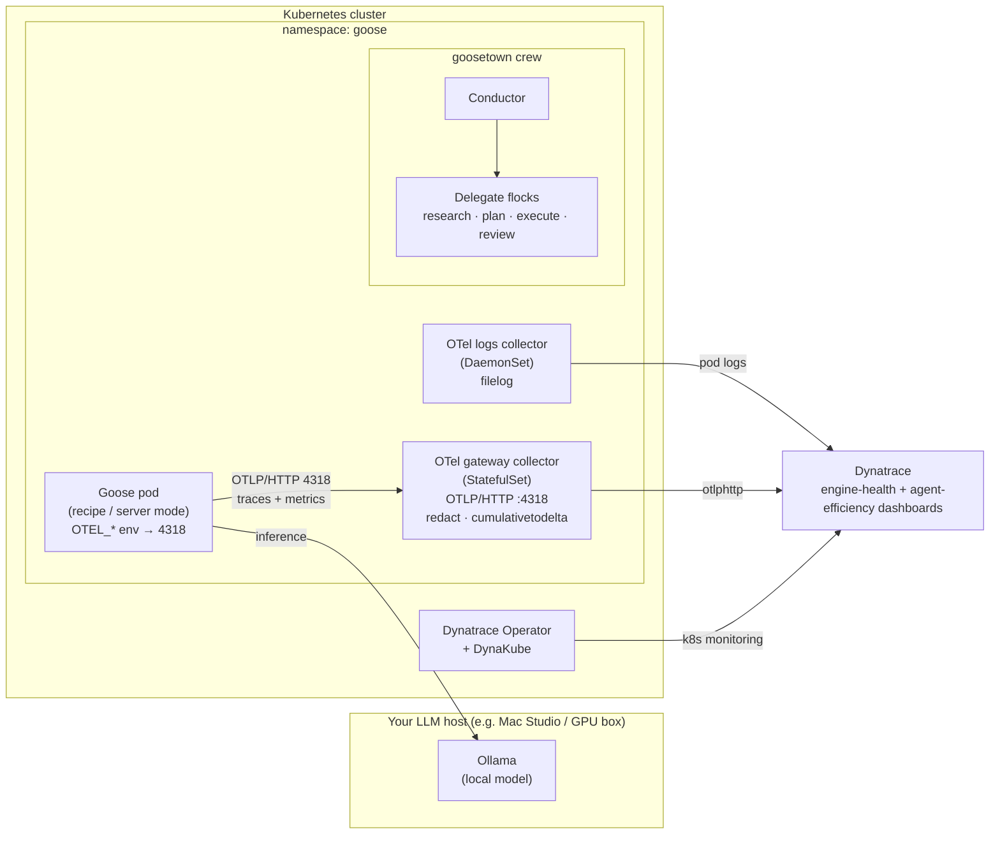
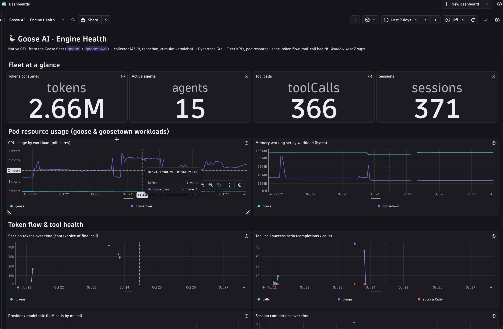
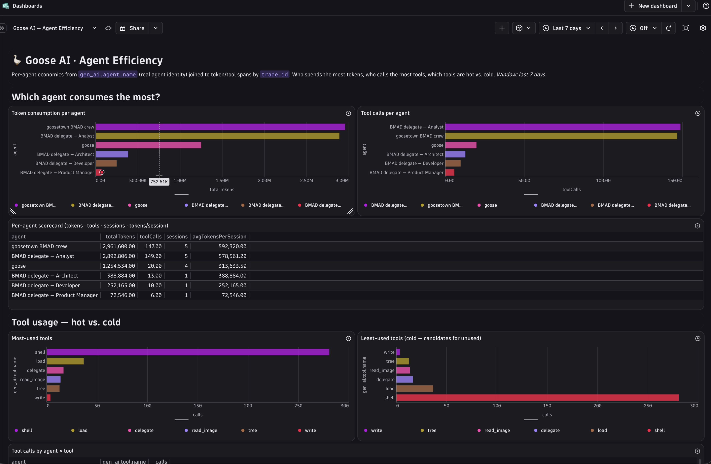

# Is it Observable
<p align="center"></p>
<p align="center"></p>

[](https://www.youtube.com/@Isitobservable)
[](https://block.github.io/goose/)
[](https://ollama.com)
[](https://modelcontextprotocol.io)
[](https://opentelemetry.io)
[](https://www.dynatrace.com)
[](./LICENSE)

> 📺 **Watch the episode:** https://www.youtube.com/@Isitobservable — *Observing Goose AI Agents — Build a BMAD Crew, Then Actually See It Work*

---

## Episode : Observing Goose AI Agents with OpenTelemetry & Dynatrace
This repository contains the files utilized during the tutorial presented in the dedicated IsItObservable episode about [Goose](https://block.github.io/goose/), [Block's](https://block.github.io/goose/) open, on-machine AI agent (Apache-2.0, written in Rust, now under the AI Agent ecosystem umbrella of the Linux Foundation).

This tutorial takes you from an empty Kubernetes cluster to a fully **observed**, BMAD-style Goose agent crew — a simple agent, MCP tools (Dynatrace + GitHub), a multi-agent orchestration (**goosetown**), and **native OpenTelemetry** flowing into Dynatrace with **zero application-code changes**. It runs against a **local qwen model via Ollama** (no external API key), packages everything for **Kubernetes**, and wires it to **OpenTelemetry → Dynatrace** so you can *see* the agents reason, call tools, hand off, and burn tokens.

We will also utilize the following components:
* **Goose `v1.46.0`** — runs *any* LLM, speaks the **Model Context Protocol (MCP)** natively (70+ extensions), and packages work as reusable **YAML recipes**
* A local **Ollama** host serving `qwen3.6` — a tool-capable qwen model, and the key-free differentiator (nothing leaves your network)
* **Native OpenTelemetry** emitted by Goose itself — no instrumentation code to write
* An **OpenTelemetry Collector** — a gateway `StatefulSet` (OTLP/HTTP :4318, redact · cumulativetodelta) plus a logs `DaemonSet` (filelog)
* The **Dynatrace Operator** to report the health of the cluster
* **MCP servers** — Dynatrace (read your telemetry) and GitHub (read and act on a repo)
* **goosetown** — the Goose Town chat UI + map that drives a **BMAD crew** (Conductor → research · plan · execute · review)

All the observability data generated by the environment would be sent to Dynatrace.

> **Why Goose here?** Goose emits **native OpenTelemetry** traces and metrics — you observe a full agent crew without writing a line of instrumentation code. The only work is routing, redacting, and reading the signals, which is exactly what this tutorial is about.

This repo is built to be **reusable**: you bring your own cluster, your own Ollama host, and your own Dynatrace tenant — all supplied through a single `.env` file. There is nothing lab-specific hard-coded anywhere.


## Prerequisite
The following tools need to be installed on your machine:
- jq
- kubectl
- git
- curl
- Helm
- [`dtctl`](https://github.com/dynatrace-oss/dtctl) (to deploy the Dynatrace dashboards)
- Network reach to an **Ollama** host with a `qwen3.6` tag pulled (IP set via `$OLLAMA_BASE_URL`)
- A k8S cluster having the admission controller enabled (for the deploy + observe track)
- A GitHub token (repo scope) for the GitHub MCP demo
- Goose CLI (optional) to run recipes locally as well as in-cluster — pinned to **v1.46.0** in this tutorial: <https://block.github.io/goose/docs/getting-started/installation>


## Getting started


### 1. Dynatrace Tenant

#### 1. Dynatrace Tenant — start a trial
If you don't have any Dynatrace tenant, then I suggest creating a trial using the following link: [Dynatrace Trial](https://dt-url.net/observable-trial)
Once you have your tenant, save the Dynatrace tenant url in the variable `DT_ENVIRONMENT_URL` (for example: https://abc12345.live.dynatrace.com)
```shell
export DT_ENVIRONMENT_URL=<YOUR TENANT Host>
```

##### 2. Create the Dynatrace API Tokens
The deployment will require two tokens:
* A token for the Dynatrace Operator to deploy and configure the cluster-health components
* A token to ingest the OpenTelemetry traces, metrics, and logs from the Goose crew

###### Operator Token
Create a Dynatrace token for the operator with the following scope:
* Create ActiveGate tokens
* Read entities
* Read Settings
* Write Settings
* Access problem and event feed, metrics and topology
* Read configuration
* Write configuration
* PaaS integration - installer download
<p align="center"></p>

Save the value of the token. We will use it later to store it in a k8S secret.
```shell
export DT_API_TOKEN=<YOUR TOKEN VALUE>
```

###### Ingest data token
Create a Dynatrace token with the following scope — this is the token the OpenTelemetry Collector uses to push GenAI telemetry:
* Ingest metrics (`metrics.ingest`)
* Ingest logs (`logs.ingest`)
* Ingest OpenTelemetry traces (`openTelemetryTrace.ingest`)
* Read metrics
<p align="center"></p>

Save the value of the token. We will use it later to store it in a k8S secret.
```shell
export DT_INGEST_TOKEN=<YOUR TOKEN VALUE>
```

##### 3. Spin up a Kubernetes cluster

This tutorial runs on **any** conformant Kubernetes cluster — you only need `kubectl` pointed at one with enough capacity to run Goose, two collectors, and the operators (the admission controller must be enabled for the deploy + observe track). Pick whichever option fits your environment; full notes and a network-values template live in [`cluster/`](cluster/).

> ⚠️ **One hard requirement, whichever option you pick:** the pods must be able to reach your Ollama host at `http://$OLLAMA_BASE_URL`. If the model is unreachable, Goose hangs on its first LLM call. For local clusters (kind/k3d) that means your machine's **LAN IP**, not `localhost`.

**Option A — local (fastest to try).**

```bash
kind create cluster --name goose      # …or k3s / k3d / minikube — all work
```

**Option B — managed (EKS / GKE / AKS).** Provision with your usual tooling (`eksctl`, `gcloud`, `az`), then point `kubectl` at it. Everything else in this repo is portable.

**Option C — self-hosted with Cluster API (Proxmox, vSphere, bare metal).** For declarative, reproducible clusters use [Cluster API](https://cluster-api.sigs.k8s.io/). The high-level flow:

1. **Carve non-overlapping IP ranges** for the control-plane VIP, the worker pool, a load-balancer pool (e.g. MetalLB), and any DHCP reserve — copy [`cluster/values.env.example`](cluster/values.env.example) to `cluster/values.env` (git-ignored) and fill in ranges that fit **your** network.
2. **Render** your infrastructure provider's manifests from those values.
3. **Apply** them to a management cluster and let the provider create the workload cluster.
4. **Pull the kubeconfig** and point `kubectl` at the new cluster.

The specifics depend on your provider (CAPMOX for Proxmox, CAPV for vSphere, …) — follow that provider's guide. This repo keeps no infrastructure-specific values.

**Verify** the cluster is ready before continuing:

```bash
kubectl cluster-info
kubectl get nodes      # wait until every node is Ready
```


### Configure — one `.env` file

Everything lab-specific lives in a single git-ignored `.env`. Copy the template and fill in **your** values:

```shell
cp .env.example .env
$EDITOR .env
```

Key variables (see [`.env.example`](.env.example) for the full annotated list):

| Variable | Purpose |
|---|---|
| `OLLAMA_BASE_URL` / `OLLAMA_MODEL` | Your Ollama host + model (default `qwen3.6`) |
| `DT_ENVIRONMENT_URL` / `DT_API_TOKEN` / `DT_INGEST_TOKEN` | Dynatrace tenant + the two tokens created above |
| `OTEL_COLLECTOR_ENDPOINT` | The gateway Service — **must be `:4318` (HTTP)**, never `:4317` (gRPC) |
| `GITHUB_TOKEN` | For the GitHub MCP demo (repo scope) |


## Architecture

Goose emits OpenTelemetry directly; the gateway Collector holds the Dynatrace Api-Token so the application never does, and redacts prompt content **before** it leaves the cluster.



The telemetry shape you get:
- **Traces** — a `gen_ai` span tree per run: session → agent → `{chat, execute_tool}`. LLM spans carry `gen_ai.usage.*` tokens, `gen_ai.request.model`, and the MCP tool calls the agent made.
- **Metrics** — token usage, session duration, and tool-call vs tool-completion counts (converted cumulative → delta at the gateway).
- **Logs** — pod logs tailed by the `DaemonSet` collector, trace-correlated.

> **The gap this closes.** Goose has **no gRPC exporter** (OTLP/HTTP `:4318` only), and `GOOSE_TELEMETRY_ENABLED` is **product analytics, not OTLP** — native OTel is driven by the standard `OTEL_*` variables. Get those two right and the whole crew is observable with zero code. Full analysis in [`docs/observability.md`](docs/observability.md).


## Step-by-Step

Every step maps to a numbered, idempotent script in [`scripts/`](scripts/) and a one-liner `make` target, so the automation and the walkthrough stay in lockstep. Run the whole path at once with `make all`, or tear it down with `make teardown`.

### Step 1: Provision a cluster

**Goal:** Bring your own conformant cluster, or stand one up with Cluster API.

**Where it runs:** Your laptop / your cloud.

See [`cluster/README.md`](cluster/README.md). Point `kubectl` at the cluster before continuing.

### Step 2: Install the operators

**Goal:** Install the OpenTelemetry + Dynatrace operators and the DynaKube CR.

```bash
make operators              # scripts/ installs the operators + applies DynaKube
```

The operator reads the `DT_API_TOKEN` (stored in a Kubernetes secret) and the `DT_ENVIRONMENT_URL`; the DynaKube CR brings up application-monitoring mode plus an ActiveGate for Kubernetes monitoring.

### Step 3: Point Goose at local qwen — key-free

**Goal:** Configure Goose so every agent talks to your local Ollama model. **No OpenAI/Anthropic key is needed** — that's the differentiator. See [`config/goose-config.yaml`](config/goose-config.yaml).

```bash
# .env already sets OLLAMA_MODEL=qwen3.6 — update OLLAMA_BASE_URL to your host, then:
curl ${OLLAMA_BASE_URL}/api/tags | grep qwen3.6
```

### Step 4: Deploy the collectors

**Goal:** Stand up the two collectors — the gateway `StatefulSet` (holds the ingest token so Goose never does) and the logs `DaemonSet`.

```bash
make deploy-collector
```

> **Collector rules (baked in):** the gateway redacts `user_message` / `trace_input` / `input` prompt attributes with a `transform` processor **before** export, and converts cumulative metrics to delta with `cumulativetodelta`.

### Step 5: Deploy Goose

**Goal:** Run Goose in-cluster, wired to Ollama and the gateway collector. See [`k8s/goose/`](k8s/goose/).

```bash
make deploy-goose
```

### Step 6: Build a simple agent, then add observability

**Goal:** Run a single Goose recipe and watch native OTel land in Dynatrace — no instrumentation code.

```bash
make simple-agent           # runs recipes/01-simple-agent.yaml
```

**Verify:** a `gen_ai` span tree for the session appears in Dynatrace, keyed by `OTEL_SERVICE_NAME=goose`, with token metrics on the LLM spans.

### Step 7: Wire the MCPs — an agent that reviews your pull requests

**Goal:** Wire two MCP servers into Goose — Dynatrace (read your telemetry) and GitHub (read and act on a repo). The GitHub MCP is what turns a chat agent into a teammate.

```bash
make wire-mcp
make review-pr              # review the latest open PR on $DEMO_REPO (recipes/05-pr-review.yaml)
make review-pr PR=42        # review PR #42
```

The [`05-pr-review.yaml`](recipes/05-pr-review.yaml) recipe **reads** a pull request (metadata, changed files, diff), writes a structured review — summary, per-file notes, and an `APPROVE` / `REQUEST_CHANGES` / `COMMENT` verdict — then **posts** it back. Because it runs inside the instrumented Goose pod, the whole read → reason → post flow shows up as one span tree.

### Step 8: Orchestrate a BMAD crew (goosetown)

**Goal:** Run a **Conductor** through a `research → plan → execute → review` loop over four **Delegate flocks**, following one golden rule: **READS run in parallel** (researcher, reviewer), **WRITES run sequentially** (planner → executor). This repo ships both ways to run it.

**1. In-process (the working default).** A Conductor runs the crew from a single recipe and spawns the five BMAD delegates — Analyst, PM, Architect, Developer, QA — as its own Goose subagent sessions. Each delegate appears as its own goose on the Goose Town map.

```bash
make crew                   # runs recipes/04-bmad-crew.yaml
```

The delegate recipes live in [`recipes/bmad/`](recipes/bmad/) (`analyst.yaml` / `pm.yaml` / `architect.yaml` / `dev.yaml` / `qa.yaml`); the descriptive flock roster is in [`config/goosetown/`](config/goosetown/). This path is **read-only** — every delegate's GitHub MCP runs with `--read-only` — so a board prompt can never trigger an unintended repository write. Because the delegates run in-process they share one `OTEL_SERVICE_NAME`; per-role breakdown is by **session name**, not `service.name` (see [`docs/observability.md`](docs/observability.md) Gotcha 5).

**2. ACP-deployed (the upgrade path).** Each role becomes its **own** Goose agent — a Deployment + Service in the cluster — so the Conductor can dispatch to the roles as addressable **ACP** (Agent Client Protocol) endpoints, each with its own `OTEL_SERVICE_NAME`.

```bash
make bmad-crew-acp          # applies k8s/goose/bmad/ then launches the conductor
```

| Role | Recipe | Access | Concurrency |
|---|---|---|---|
| Conductor | [`conductor.yaml`](recipes/bmad/conductor.yaml) | ACP client (dispatches) | orchestrates |
| Researcher | [`researcher.yaml`](recipes/bmad/researcher.yaml) | read-only · GitHub + Dynatrace MCP | parallel-safe |
| Planner | [`planner.yaml`](recipes/bmad/planner.yaml) | writes the plan only (no MCP) | sequential |
| Executor | [`executor.yaml`](recipes/bmad/executor.yaml) | writes repo · GitHub MCP | sequential |
| Reviewer | [`reviewer.yaml`](recipes/bmad/reviewer.yaml) | read-only · GitHub MCP | parallel-safe |

> **⭐ Trace continuity — verified against v1.46.0.** The point of the ACP form is to see the whole crew run as **one distributed trace** spanning the per-role service names, which only works if the Conductor propagates the W3C `traceparent` across each ACP hop — the same crux the CrewAI episode hit. We checked the pinned Goose **v1.46.0** and it does **not** support this yet (`goose acp` runs on stdio only — ACP-over-HTTP is unreleased upstream, goose issue [#6642](https://github.com/block/goose/issues/6642) — and it does not auto-forward `traceparent`). **So the in-process `make crew` is the working default; `recipes/bmad/` + `k8s/goose/bmad/` are the documented upgrade path.** The observability story (per-role spans, redaction, delta metrics) is identical either way. Full analysis: [`docs/observability.md` §6](docs/observability.md).

### Step 9: Deploy the dashboards and run the crew from the chat UI

**Goal:** Deploy the two dashboards, then type a goal into a chat box and watch them fill with live telemetry.

```bash
make dashboards             # dtctl apply -f dashboards/*.yaml
make goosetown              # the Goose Town chat UI + map
```

**Open the chat UI.** goosetown exposes a `LoadBalancer` carrying both the map (port 80) and the chat interface (port 4251):

```bash
kubectl -n goosetown get svc goosetown-ui
# → open  http://<EXTERNAL-IP>:4251   (or port-forward svc/goosetown-ui 4251:4251)
```

**Submit a goal.** Each message is treated as an independent **crew goal**: the server launches the in-process BMAD crew (`recipes/04-bmad-crew.yaml`) with `--params goal=<message>`, and the Conductor spawns the five delegates. The whole path is **read-only** (`GITHUB_READ_ONLY=1`), so a typed goal can never trigger a repository write. A safe first goal:

```
Add a /healthz endpoint to the sample service
```

**Watch the dashboards fill.** This is the reliable, demonstrable result — within seconds, both dashboards come alive.

> **About the village map.** The chat UI ships alongside a Goose Town village map; the same session names that split the dashboards light the geese on it. Treat the animated map as a work in progress — the dependable, demoable result today is the **dashboards filling**, the signal that the chat → crew → telemetry path works end to end.

### Step 10: Teardown

```bash
make teardown
```


## The observability gotchas (read these before you debug)

Three things trip up almost everyone wiring Goose to OpenTelemetry. They are covered in depth in [`docs/observability.md`](docs/observability.md); the short version:

1. **Goose speaks OTLP/HTTP only — use port `4318`, never `4317`.** Goose has no gRPC exporter. Point `OTEL_EXPORTER_OTLP_ENDPOINT` at the collector's **HTTP** receiver or you'll see nothing.

2. **`GOOSE_TELEMETRY_ENABLED` is product analytics, *not* OTLP.** Turning it on does **not** send traces to your collector. Native OTel is controlled by the standard `OTEL_*` environment variables. (Same trap the CrewAI episode hit.)

3. **Redact prompt content before it leaves the cluster.** Goose spans can carry `user_message`, `trace_input`, and `input` attributes containing raw prompts. The gateway collector drops these with a `transform` processor **before** export so prompts never land in your backend.


## Observability / Dashboards

Two dashboards ship as `dtctl`-deployable YAML in [`dashboards/`](dashboards/). Deploy them with the dashboard tooling:

```bash
dtctl apply -f dashboards/*.yaml   # or: make dashboards
```

### Goose — Engine Health
*Is the crew up and succeeding?* Fleet KPIs (tokens consumed, active agents, tool calls, sessions), pod resource usage for the `goose` and `goosetown` workloads, and token-flow / tool-call-success health — alongside Kubernetes workload health reported by the Dynatrace Operator.

<p align="center"></p>

### Goose — Agent Efficiency
*Is the crew working well and economically?* Per-agent economics from `gen_ai.agent.name` joined to token/tool spans by `trace.id` — who spends the most tokens, who calls the most tools, which tools are hot vs cold — keyed by session / delegate name (`bmad-analyst`, `bmad-pm`, `bmad-architect`, `bmad-dev`, `bmad-qa`).

<p align="center"></p>

> Because the in-process chat crew shares one `service.name` (`goose-goosetown`), the per-role breakdown is by **session / delegate name**, not by `service.name` — see [`docs/observability.md`](docs/observability.md) Gotcha 5. For a write-capable, per-service-name crew, use the ACP form (Step 8.2).


## Repository layout

```
.
├── README.md              ← you are here
├── .env.example           ← copy to .env, set YOUR parameters
├── Makefile               ← one-liner targets wrapping scripts/
├── docs/                  ← architecture + observability deep-dive
├── cluster/               ← bring-your-own-cluster notes + values template
├── recipes/               ← Goose recipes (the reusable, shareable unit)
├── config/                ← goose config + goosetown crew definitions
├── k8s/                   ← operators, collectors, Goose deployment
├── dashboards/            ← Dynatrace dashboards (dtctl YAML)
├── chat-ui/               ← goosetown chat interface + map
├── image/                 ← logos + dashboard & Dynatrace setup screenshots
└── scripts/               ← numbered, idempotent deploy scripts
```


## Resources

- [Goose documentation](https://block.github.io/goose/) — recipes, extensions (MCP), providers
- [Goose GitHub](https://github.com/block/goose)
- [Model Context Protocol (MCP)](https://modelcontextprotocol.io)
- [OpenTelemetry GenAI semantic conventions](https://opentelemetry.io/docs/specs/semconv/gen-ai/)
- [OpenTelemetry Collector Contrib](https://github.com/open-telemetry/opentelemetry-collector-contrib)
- [Ollama](https://ollama.com)
- [Dynatrace Trial](https://dt-url.net/observable-trial)
- [Is it Observable](https://isitobservable.io) — the tutorial series
- Companion episode: [CrewAI](https://github.com/isItObservable/CrewAI)
- [BMAD-METHOD](https://github.com/bmad-code-org/BMAD-METHOD) — the HITL methodology the crew implements
- `docs/observability.md` — the full observability deep-dive


## License

Apache-2.0 — see [LICENSE](./LICENSE).

---
<p align="center">Made with ☕ and OpenTelemetry by <a href="https://isitobservable.io">Is it Observable</a></p>
