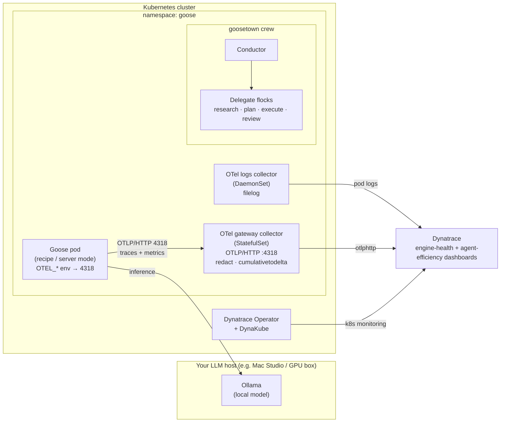

# Observing Goose AI Agents with OpenTelemetry & Dynatrace

Go from an empty Kubernetes cluster to a fully **observed**, BMAD-style
[Goose](https://block.github.io/goose/) agent crew — a simple agent, MCP tools
(Dynatrace + GitHub), a multi-agent orchestration, and native OpenTelemetry
flowing into Dynatrace with **zero application code changes**.

This is the companion repository for the *isItObservable* Goose AI episode. It is
built to be **reusable**: you bring your own cluster, your own Ollama host, and
your own Dynatrace tenant — all supplied through a single `.env` file. There is
nothing lab-specific hard-coded anywhere.

> **What is Goose?** Goose is [Block's](https://block.github.io/goose/) open,
> on-machine AI agent (Apache-2.0, written in Rust, now under the AI Agent
> ecosystem umbrella of the Linux Foundation). It runs *any* LLM — including a
> local [Ollama](https://ollama.com/) model, so nothing leaves your network —
> speaks the **Model Context Protocol (MCP)** natively (70+ extensions), and
> packages work as reusable **YAML recipes**. Crucially for us, recent Goose
> emits **native OpenTelemetry** traces and metrics: you observe it without
> writing a line of instrumentation code.

---

## Architecture



The Goose pod runs your recipes and talks to a **local Ollama** model for
inference (nothing leaves your network). It exports **native OpenTelemetry** over
**OTLP/HTTP on port 4318** to an in-cluster **gateway collector** (a
`StatefulSet`), which redacts prompt content, converts cumulative metrics to
delta, and forwards to **Dynatrace**. A second **DaemonSet** collector tails pod
logs. Two Dynatrace dashboards visualise **engine health** and **agent
efficiency**.

---

## Prerequisites

| You need | Notes |
|---|---|
| A Kubernetes cluster | Any conformant cluster: kind/k3s for local, or EKS/GKE/AKS, or a Proxmox + Cluster API setup. See [`cluster/`](cluster/). |
| `kubectl` + `helm` | Pointed at your cluster. |
| An Ollama host | Reachable from the cluster. A Mac Studio, a GPU workstation, or any Ollama server. |
| A Dynatrace tenant | SaaS or Managed, plus API + data-ingest tokens. |
| A GitHub token | For the GitHub MCP demo (repo scope). |
| Goose CLI (optional) | To run recipes locally as well as in-cluster: <https://block.github.io/goose/docs/getting-started/installation>. Pinned to **v1.46.0** in this tutorial. |

---

## Quickstart

```bash
# 1. Configure — copy the template and fill in YOUR values
cp .env.example .env
$EDITOR .env

# 2. Install the operators (OpenTelemetry + Dynatrace) and the DynaKube
make operators

# 3. Deploy the two collectors (logs DaemonSet + gateway StatefulSet)
make deploy-collector

# 4. Deploy Goose (wired to Ollama + the collector)
make deploy-goose

# 5. Run a simple agent, then add MCP tools, then the full crew
make simple-agent
make wire-mcp
make crew

# 6. Publish the Dynatrace dashboards
make dashboards
```

Or run the whole path at once: `make all`. Tear it all down with `make teardown`.

Each step maps to a numbered script in [`scripts/`](scripts/) and a tutorial
section below, so the automation and the walkthrough stay in lockstep.

---

## Tutorial sections

0. **Prerequisites & architecture** — this page.
1. **[Provision a cluster](cluster/README.md)** — bring your own, or use Cluster API.
2. **Install the operators** — [`k8s/operators/`](k8s/operators/) · `make operators`.
3. **Point Goose at Ollama** — [`config/goose-config.yaml`](config/goose-config.yaml).
4. **Deploy Goose** — [`k8s/goose/`](k8s/goose/) · `make deploy-goose`.
5. **Build a simple agent** — [`recipes/01-simple-agent.yaml`](recipes/01-simple-agent.yaml).
6. **Wire the MCPs** — [`recipes/02-dynatrace-mcp.yaml`](recipes/02-dynatrace-mcp.yaml), [`03-github-mcp.yaml`](recipes/03-github-mcp.yaml).
7. **Orchestrate a BMAD crew (goosetown)** — [`config/goosetown/`](config/goosetown/).
8. **Observe it** — [`docs/observability.md`](docs/observability.md) · dashboards in [`dashboards/`](dashboards/).
9. **Teardown** — `make teardown`.

---

## The observability gotchas (read these before you debug)

Three things trip up almost everyone wiring Goose to OpenTelemetry. They are
covered in depth in [`docs/observability.md`](docs/observability.md); the short
version:

1. **Goose speaks OTLP/HTTP only — use port `4318`, never `4317`.** Goose has no
   gRPC exporter. Point `OTEL_EXPORTER_OTLP_ENDPOINT` at the collector's **HTTP**
   receiver or you'll see nothing.

2. **`GOOSE_TELEMETRY_ENABLED` is product analytics, *not* OTLP.** Turning it on
   does **not** send traces to your collector. Native OTel is controlled by the
   standard `OTEL_*` environment variables. (Same trap the CrewAI episode hit.)

3. **Redact prompt content before it leaves the cluster.** Goose spans can carry
   `user_message`, `trace_input`, and `input` attributes containing raw prompts.
   The gateway collector drops these with a `transform` processor **before**
   export so prompts never land in your backend.

---

## Repository layout

```
.
├── README.md              ← you are here
├── .env.example           ← copy to .env, set YOUR parameters
├── Makefile               ← one-liner targets wrapping scripts/
├── docs/                  ← architecture + observability deep-dive
├── cluster/               ← bring-your-own-cluster notes + values template
├── recipes/               ← Goose recipes (the reusable, shareable unit)
├── config/                ← goose config + goosetown crew definitions
├── k8s/                   ← operators, collectors, Goose deployment
├── dashboards/            ← Dynatrace dashboards (JSON)
└── scripts/               ← numbered, idempotent deploy scripts
```

## License

Apache-2.0 — see [LICENSE](LICENSE).
