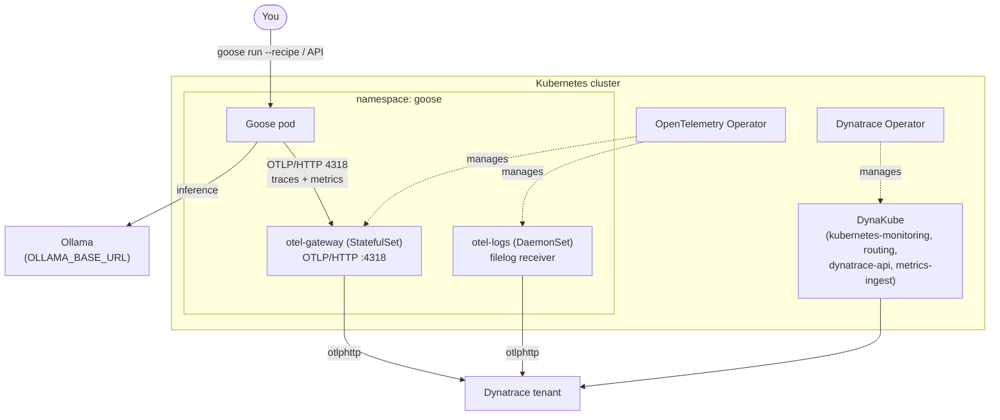

# Architecture

This tutorial deploys four things and wires them together:

1. **Goose** — the on-machine AI agent, running in a Kubernetes pod, executing
   YAML recipes and (optionally) a multi-agent *goosetown* crew.
2. **Ollama** — a local LLM host that Goose uses for inference, so no prompt or
   completion ever leaves your network.
3. **An OpenTelemetry collection tier** — two collectors deployed by the
   OpenTelemetry Operator: a gateway (`StatefulSet`) for Goose traces + metrics,
   and a logs collector (`DaemonSet`) for pod logs.
4. **Dynatrace** — the observability backend, fed by the collectors and by the
   Dynatrace Operator's DynaKube.

## End-to-end flow

## Why these choices

**Ollama for inference.** Goose is provider-agnostic. We use a local Ollama host
so the demo is private and free to run. `OLLAMA_BASE_URL` in `.env` points Goose
at your host — a Mac Studio, a GPU workstation, or any Ollama server reachable
from the cluster. In production you would swap in any provider Goose supports.

**Two collectors, one operator.** The OpenTelemetry Operator lets us declare
collectors as `OpenTelemetryCollector` custom resources and it manages the
underlying workloads:

- A **gateway** collector as a `StatefulSet` — stable network identity and a
  durable sending queue on the ingest path for Goose's traces and metrics.
- A **logs** collector as a `DaemonSet` — exactly one log tailer per node, the
  standard topology for pod-log collection with the `filelog` receiver.

**DynaKube scoped, not full-stack.** The Dynatrace Operator is installed with a
DynaKube limited to `kubernetes-monitoring`, `routing`, `dynatrace-api`, and
`metrics-ingest`. We do **not** deploy full-stack OneAgent — the goal is to
observe the *agent*, and the OTLP path plus Kubernetes monitoring is enough.

**OTLP/HTTP on 4318.** Goose exports over OTLP/HTTP only. The gateway's OTLP
receiver listens on `4318`. See [observability.md](observability.md) for the full
signal reference and the three gotchas.

## Networking notes

- The **collector endpoint** Goose uses is the in-cluster gateway Service:
  `http://otel-gateway-collector.<namespace>.svc.cluster.local:4318`
  (set via `OTEL_COLLECTOR_ENDPOINT`).
- The **Ollama endpoint** must be reachable from inside the cluster. If Ollama
  runs outside the cluster (typical — it's on your Mac/GPU box), use its LAN
  IP/hostname, not `localhost`. `k8s/goose/` shows both patterns (env var, or a
  headless Service + Endpoints object mapping to the external host).
